<p align="center">
  <picture>
    <source media="(prefers-color-scheme: dark)" srcset="https://raw.githubusercontent.com/KhaledSaeed18/team-flow/main/assets/brand/teamflow-logo-dark.png" />
    
  </picture>
</p>

<p align="center">A real-time, keyboard-first agile workspace.</p>

<p align="center">
  <a href="https://github.com/KhaledSaeed18/team-flow/actions/workflows/ci.yml"><picture><source media="(prefers-color-scheme: dark)" srcset="https://shieldcn.dev/github/ci/KhaledSaeed18/team-flow.svg?workflow=ci.yml&branch=main&mode=dark&variant=outline&size=sm" /></picture></a>
  <a href="https://github.com/KhaledSaeed18/team-flow/blob/main/LICENSE"><picture><source media="(prefers-color-scheme: dark)" srcset="https://shieldcn.dev/github/license/KhaledSaeed18/team-flow.svg?mode=dark&variant=outline&size=sm" /></picture></a>
  <a href="https://github.com/KhaledSaeed18/team-flow/commits/main"><picture><source media="(prefers-color-scheme: dark)" srcset="https://shieldcn.dev/github/last-commit/KhaledSaeed18/team-flow.svg?mode=dark&variant=outline&size=sm" /></picture></a>
</p>

<p align="center">
  <a href="https://bun.sh"><picture><source media="(prefers-color-scheme: dark)" srcset="https://shieldcn.dev/badge/Bun-1.4-gray.svg?mode=dark&variant=outline&size=sm&logo=bun" /></picture></a>
  <a href="https://www.typescriptlang.org"><picture><source media="(prefers-color-scheme: dark)" srcset="https://shieldcn.dev/badge/TypeScript-7-blue.svg?mode=dark&variant=outline&size=sm&logo=typescript" /></picture></a>
  <a href="https://hono.dev"><picture><source media="(prefers-color-scheme: dark)" srcset="https://shieldcn.dev/badge/Hono-oRPC-orange.svg?mode=dark&variant=outline&size=sm&logo=hono" /></picture></a>
  <a href="https://react.dev"><picture><source media="(prefers-color-scheme: dark)" srcset="https://shieldcn.dev/badge/React-19-blue.svg?mode=dark&variant=outline&size=sm&logo=react" /></picture></a>
  <a href="https://www.postgresql.org"><picture><source media="(prefers-color-scheme: dark)" srcset="https://shieldcn.dev/badge/PostgreSQL-18-blue.svg?mode=dark&variant=outline&size=sm&logo=postgresql" /></picture></a>
  <a href="https://orm.drizzle.team"><picture><source media="(prefers-color-scheme: dark)" srcset="https://shieldcn.dev/badge/Drizzle-ORM-green.svg?mode=dark&variant=outline&size=sm&logo=drizzle" /></picture></a>
</p>

TeamFlow is a planning workspace for software teams: a board, a list, a calendar and sprint planning over the same
tasks. Changes appear for everyone within a second, two people can write the same description at once, every action
has a keystroke, and the whole stack runs on one PostgreSQL database.

<p align="center">
  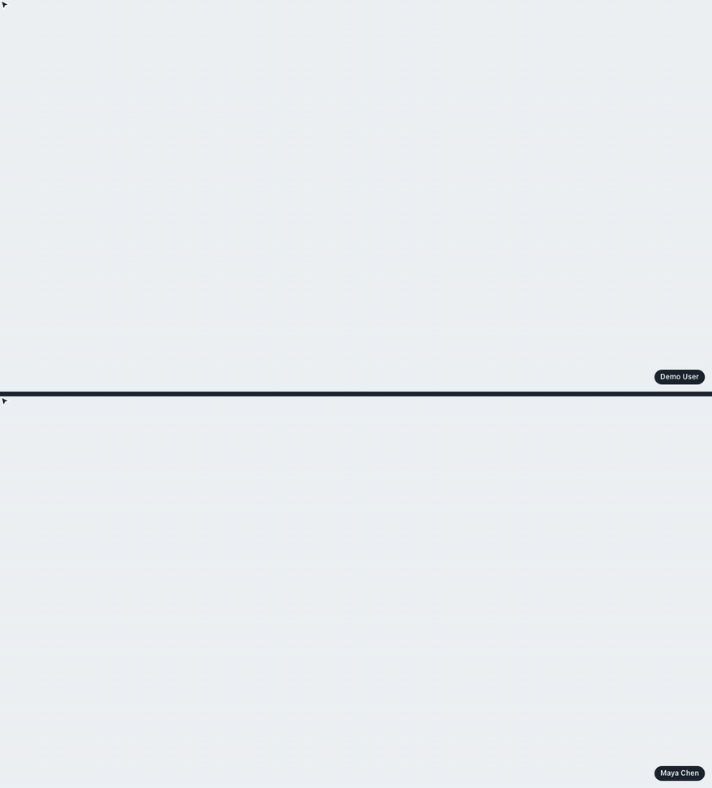
  <br />
  <sub>Two people on one board, recorded live: Demo User on top, Maya Chen below.</sub>
</p>

> v2 is a full rewrite. The original NestJS + Prisma REST API is kept at tag
> [`v1.0.0`](https://github.com/KhaledSaeed18/team-flow/tree/v1.0.0).

## Contents

- [Highlights](#highlights)
- [What it does](#what-it-does)
- [A closer look](#a-closer-look)
- [The site, the docs and the API reference](#the-site-the-docs-and-the-api-reference)
- [Architecture](#architecture)
- [Repository structure](#repository-structure)
- [Technical decisions](#technical-decisions)
- [Quality](#quality)
- [Stack](#stack)
- [Running it](#running-it)

## Highlights

- **Real-time by construction.** Every write commits its change, its history and its event in one transaction. A
  worker relays events through Postgres `LISTEN/NOTIFY` to a WebSocket gateway, so an event can be late but is never
  lost, and clients apply only versions newer than the one they hold.
- **Writing together.** Task descriptions are Yjs documents in a Tiptap editor, with each person's caret labelled by
  name, persisted on the server and indexed for search.
- **One contract, three surfaces.** Procedures are declared once with oRPC and Zod. The web app gets a typed client,
  third parties get REST under `/api/v1`, and the OpenAPI document and reference are generated from the same source.
- **Honest metrics.** Burndown, scope change, cumulative flow, velocity and cycle time are replayed from an
  append-only activity log, not kept as counters that drift.
- **Postgres does it all.** Data, jobs (pg-boss), fan-out (`LISTEN/NOTIFY`), full-text and fuzzy search. No Redis.
- **Keyboard and screen reader first.** React Aria components, drag and drop by keyboard, a ⌘K palette and
  shortcuts for every view, in light and dark, down to a phone.

## What it does

**Plan and track**

- Workspaces with roles (owner, admin, member, guest), email invitations and an organization switcher.
- Projects with keys (`RF-12`) and their own workflows: add, rename, reorder and recategorize statuses, and move the
  tasks of a deleted status somewhere sensible.
- Tasks with priority, estimates, labels, assignees, due dates, sub-tasks and relations (blocks, relates,
  duplicates; a two-way block is refused).
- Four views of the same work:
  - a **board** with accessible drag and drop (pointer, keyboard and screen reader);
  - a virtualized **list** with filters, sorting and private or shared saved views;
  - a **calendar** where you drag a card to reschedule it, or into a tray to clear its date;
  - **sprint planning**, with work dragged between sprints and the backlog.
- Sprints with carry-over and a report: burndown, scope change, cumulative flow, velocity and cycle time.

**Work together**

- Live updates and presence: you can see who is in a project and which task each person has open.
- Descriptions written together, character by character, with named carets.
- Comments with @mentions and reactions, file attachments (uploaded through the API, downloaded with signed URLs).
- An inbox with live toasts, and daily or weekly email digests of what is unread.

**Find and control**

- Full-text search across tasks and comments with typo tolerance, from a ⌘K palette that also runs actions.
- Keyboard shortcuts for everything (`?` lists them), including `g b`, `g l`, `g c`, `g p` to switch views and `c` to
  create a task.
- A typed public REST API with personal access tokens (read-only or read-write, optional expiry, one workspace each).
- Account settings: profile, password, active sessions (sign out other devices) and tokens.
- An audit log for admins: people, invitations, projects, workflows, labels, sprints and tokens.

**Everywhere**

- Light and dark themes, each chosen colour by colour.
- A responsive layout: on a phone the sidebar folds into a drawer, tasks open full screen and wide views scroll
  sideways.
- Branded emails (React Email) and one mark across the app, site, docs and README.

## A closer look

|                                                                                                        |                                                                                           |
| ------------------------------------------------------------------------------------------------------ | ----------------------------------------------------------------------------------------- |
| 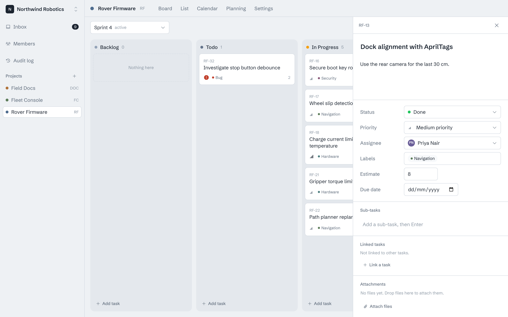                        | 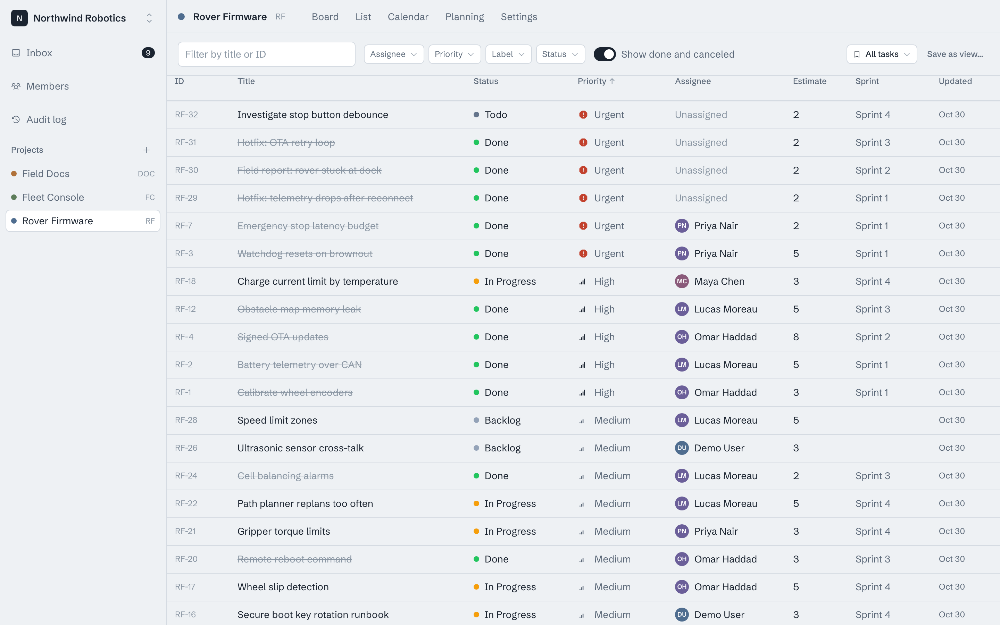       |
| **Board.** Move cards by pointer or keyboard; the open task is the same one everyone else sees, live.  | **List.** Filter by person, priority, label or status, and save the result as a view.     |
| 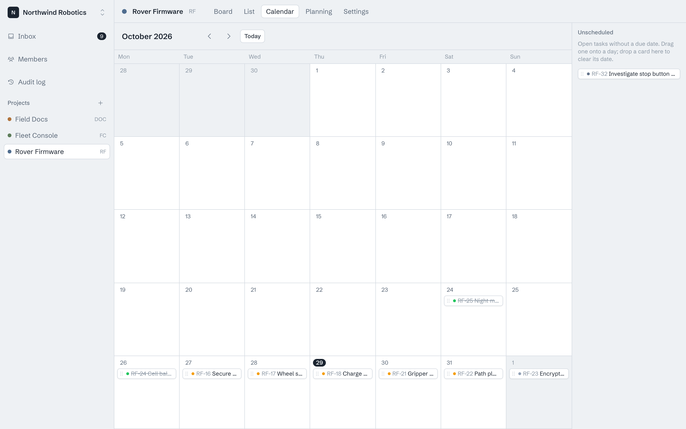                    | 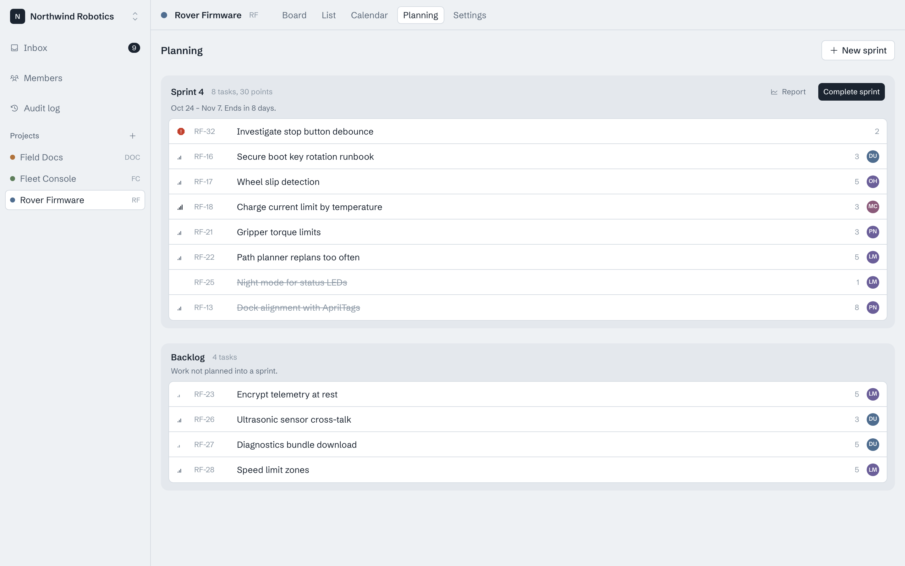 |
| **Calendar.** Drag a card to another day, or into the tray to unschedule it.                           | **Planning.** Drag work between sprints and the backlog, with the keyboard too.           |
| 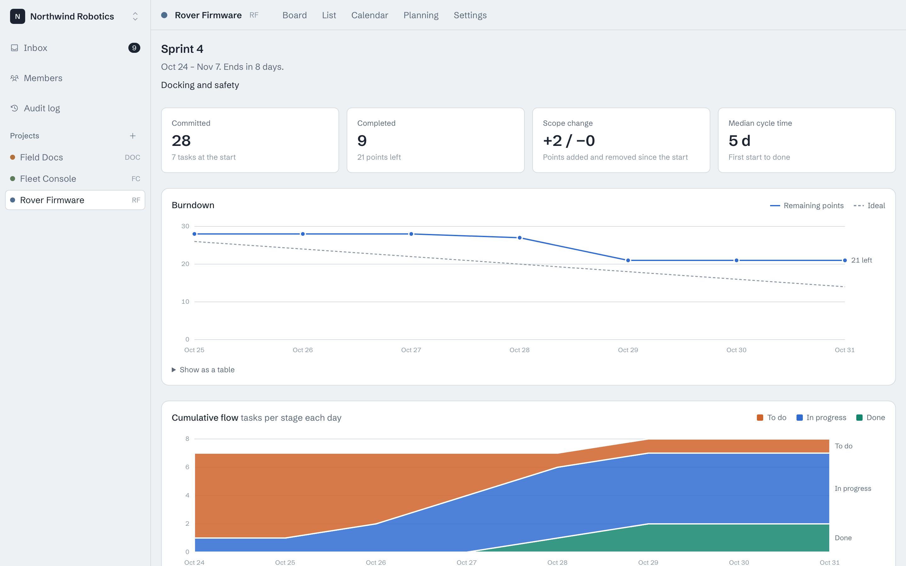            | 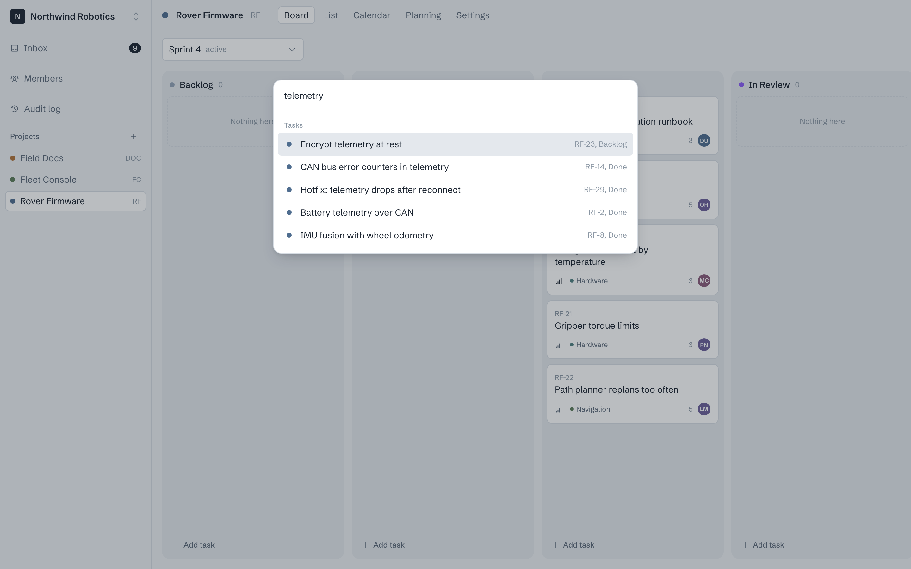          |
| **Sprint report.** Burndown, cumulative flow, velocity and cycle time, replayed from the activity log. | **⌘K.** Search tasks, projects and actions, including what was said in comments.          |
| 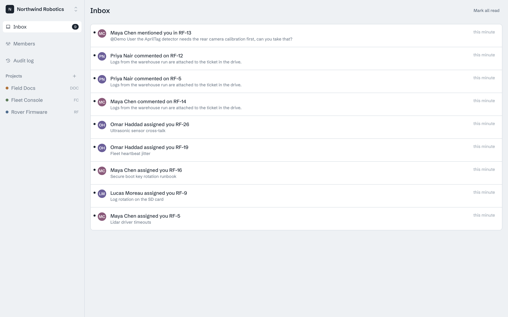             | 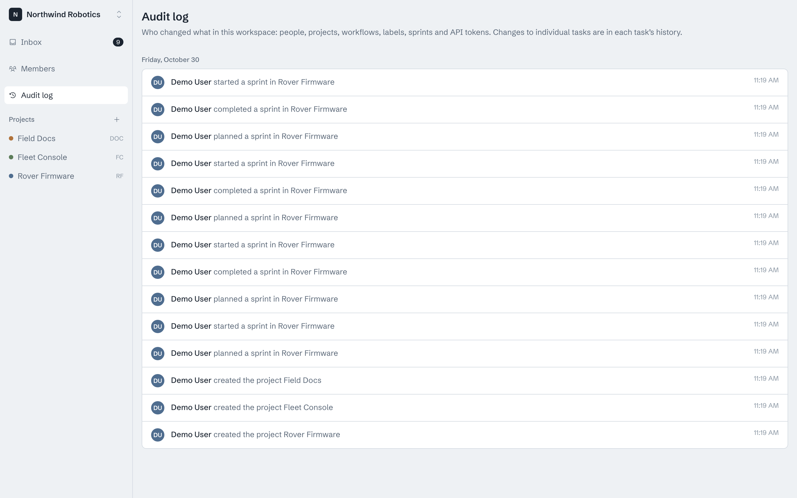                        |
| **Inbox.** Mentions, comments and assignments, with live toasts and email digests.                     | **Audit log.** Who changed what in the workspace, grouped by day.                         |
| 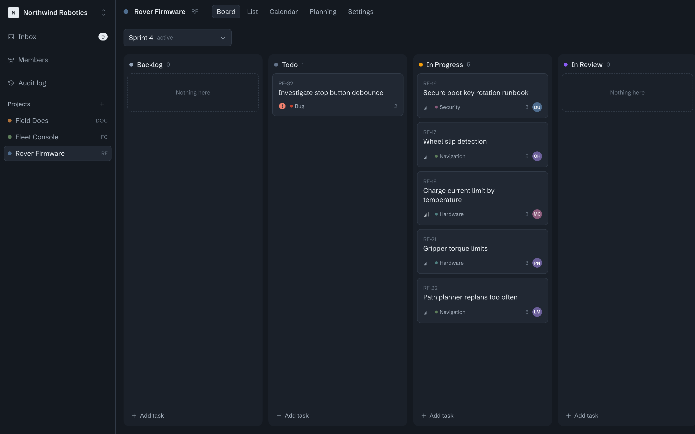                            | 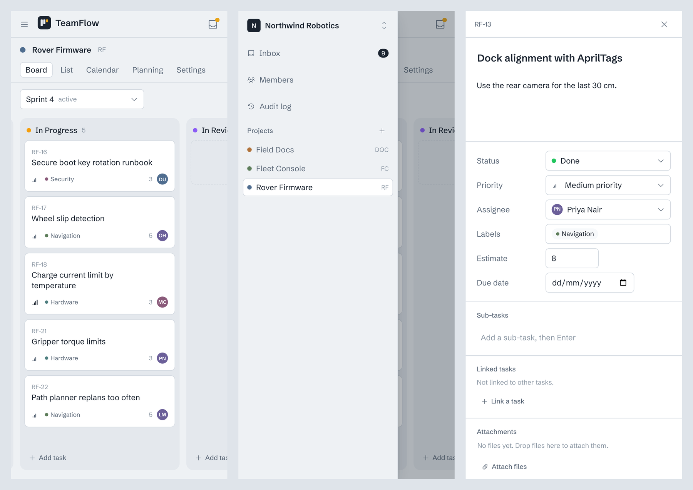 |
| **Dark theme**, chosen step by step rather than inverted.                                              | **On a phone.** A navigation drawer, the board, and a task opened full screen.            |

## The site, the docs and the API reference

|                                                                                                    |                                                                                                    |
| -------------------------------------------------------------------------------------------------- | -------------------------------------------------------------------------------------------------- |
| 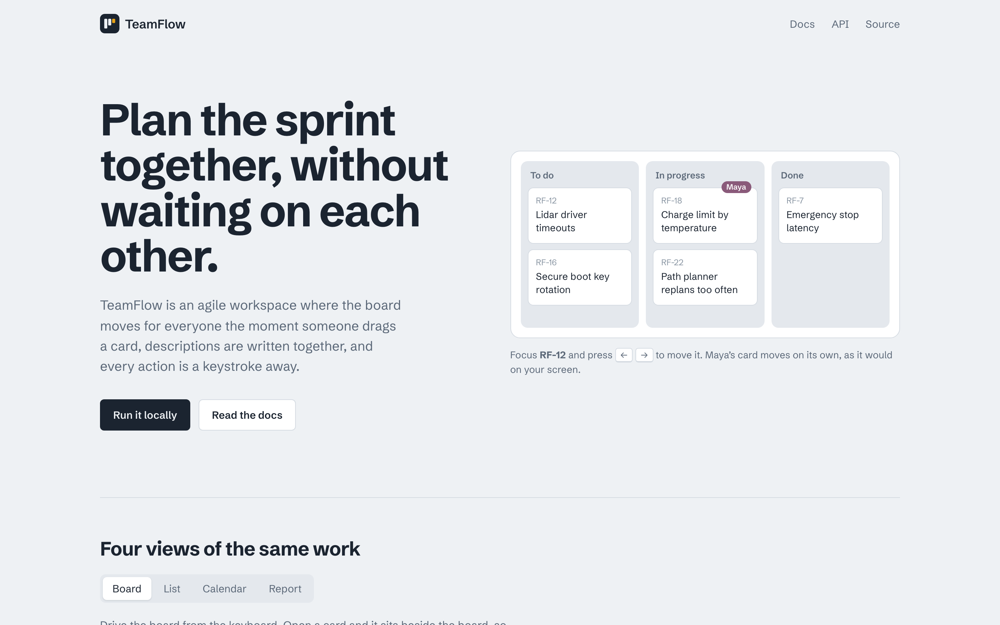                                | 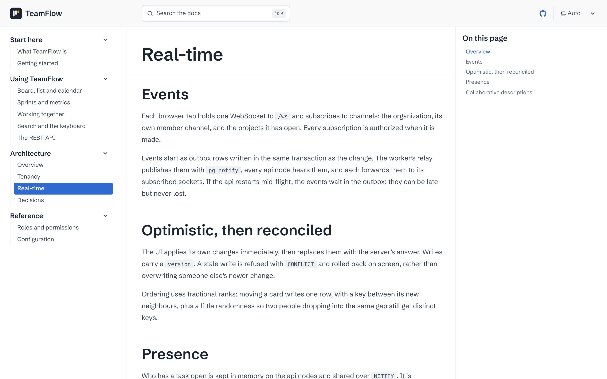              |
| **Landing page.** Astro, near-zero JavaScript, with a small board you can drive from the keyboard. | **Docs.** Starlight: getting started, guides for every view, the architecture, roles and settings. |

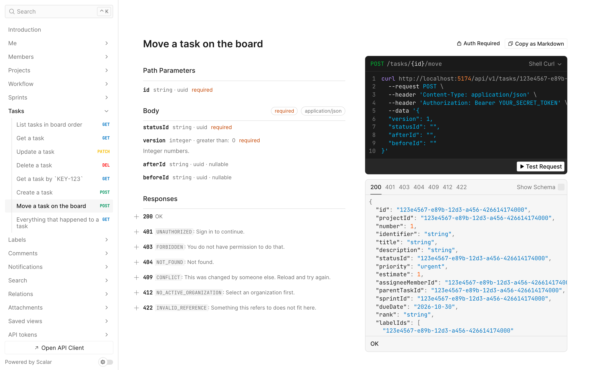

**API reference.** Scalar, served by the API at `/api/docs` from the OpenAPI document the contract generates, so it
cannot drift from the code. Every operation lists its errors (`409` for a stale version, `412`, `422` and so on).

The docs site (`apps/site`, http://localhost:4321/docs/ in development) covers:

- **Start here:** what TeamFlow is, and getting started.
- **Using TeamFlow:** board, list and calendar; sprints and metrics; working together; search and the keyboard; the
  REST API.
- **Architecture:** overview, tenancy, real-time, and the decisions.
- **Reference:** roles and permissions, and configuration.

## Architecture

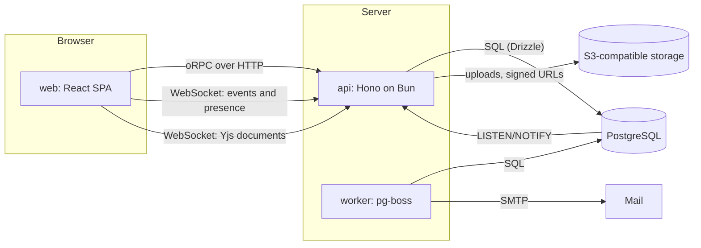

Two stateful services, PostgreSQL and object storage. Any number of API nodes can run side by side, because they
share events and presence through Postgres.

**A request.** Hono middleware adds a request id, structured logs, secure headers and CORS. Better Auth turns the
session cookie (or, on `/api/v1`, a `Bearer tf_…` token) into a user. oRPC middleware builds the context: the actor,
the active organization, the member's role, and a `Scope` that is the only way to reach tenant-owned tables. The
procedure validates input against the contract, a service authorizes against the loaded resource, and errors are
typed (`NOT_FOUND`, `FORBIDDEN`, `CONFLICT`, …) and declared in the contract.

**A write.** One transaction changes the rows, appends to `activity` (the history that metrics replay) and appends to
`outbox`. A trigger wakes the relay in the worker, which publishes the event with `NOTIFY`; every API node forwards
it to the sockets subscribed to that channel. Notifications are written in the same transaction and only announced
through the outbox, and email goes out as pg-boss jobs.

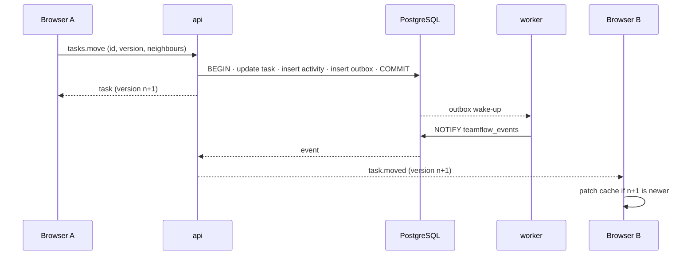

**Real-time.** One WebSocket per tab, multiplexed over channels (`org`, `me`, `project:<id>`), each authorized when
joined and re-checked when access changes. Events carry ids and the new `version`; the client patches its TanStack
Query cache and ignores anything not newer than what it has, its own optimistic writes included. Presence lives in
memory on each API node and is shared over `NOTIFY`, never in a table.

**Ordering.** Columns and the backlog are ordered by fractional keys, so a move writes one row and the client can
compute the same key before the server answers. A random suffix keeps two people dropping into the same gap apart.
A nightly job re-keys any column whose keys have grown long, under a per-column advisory lock that moves share.

**Tenancy.** One schema, `organization_id` on every tenant-owned table, enforced in the application: repositories
only take a `Scope`, foreign keys between tenant tables are composite (`organization_id, id`) so a row cannot point
across workspaces even if a query is wrong, and a test walks the schema to make sure every table has the column, the
key and a case in the isolation suite.

**Metrics.** Burndown, scope change, velocity, cycle time and cumulative flow are pure functions in
`packages/domain`, replayed over one sprint's activity. The same code runs in tests with an injected clock.

The full write-up is in [`docs/ARCHITECTURE.md`](docs/ARCHITECTURE.md) and the docs site.

## Repository structure

```
apps/
  api/        Hono on Bun: oRPC procedures, OpenAPI, Better Auth routes, WebSocket and Yjs gateway
  worker/     pg-boss: outbox relay, email delivery, digests, outbox pruning, rank rebalancing
  web/        Vite + React 19 SPA: TanStack Router and Query, React Aria, Tailwind v4, Playwright
  site/       Astro landing page and Starlight docs
packages/
  contract/   oRPC contract and Zod schemas, the single source of every wire shape
  db/         Drizzle schema, migrations, seed, repositories and the tenant Scope
  domain/     Pure logic with no I/O: workflows, ordering, filters, metrics, digests
  auth/       Better Auth config and the access-control statements shared by api and web
  realtime/   Event envelope, channel names and the socket protocol
  email/      React Email templates
  ui/         Design tokens and React Aria based components
  tsconfig/   Shared TypeScript configs
docs/         Vision, architecture, roadmap, conventions and decision records
```

Dependencies only point one way: `apps → packages`, and inside packages `contract → domain` and `db → domain`.
`domain` depends on nothing but Zod, and the web app never imports `db`. Each API feature is layered as handler →
service → repository: handlers hold no rules, services authorize against loaded resources, and only `packages/db`
touches tables.

## Technical decisions

Each decision has a short record in [`docs/adr`](docs/adr/README.md), written before or with the code it governs.

| #                                                         | Decision                                         | Why, in one line                                                                                 |
| --------------------------------------------------------- | ------------------------------------------------ | ------------------------------------------------------------------------------------------------ |
| [0001](docs/adr/0001-bun-and-turborepo.md)                | Bun and Turborepo                                | One fast runtime for install, scripts, tests and the server; cached tasks across the monorepo.   |
| [0002](docs/adr/0002-hono-and-orpc.md)                    | Hono and oRPC, contract first                    | Types flow from one contract to the client, the REST API and the OpenAPI document.               |
| [0003](docs/adr/0003-drizzle-orm.md)                      | Drizzle with SQL-first migrations                | Queries read like SQL, and migrations are reviewed as SQL.                                       |
| [0004](docs/adr/0004-application-layer-tenancy.md)        | Tenancy in a scoped query layer, not RLS         | Composite keys and a schema-walking test make the boundary structural without database policies. |
| [0005](docs/adr/0005-better-auth.md)                      | Better Auth                                      | Sessions, organizations, invitations and roles without writing an auth system.                   |
| [0006](docs/adr/0006-postgres-only-runtime.md)            | Postgres for jobs, pub/sub and search            | One stateful service to run and back up; no Redis.                                               |
| [0007](docs/adr/0007-outbox-and-activity-log.md)          | Transactional outbox and activity log            | Events can be late but never lost, and metrics replay real history.                              |
| [0008](docs/adr/0008-fractional-ordering.md)              | Fractional ranks                                 | One row per move, no renumbering; a locked rebalance when keys grow.                             |
| [0009](docs/adr/0009-vite-spa-with-tanstack.md)           | A Vite SPA with TanStack, not SSR                | Everything is behind sign-in and live over a socket; the public pages are a separate Astro site. |
| [0010](docs/adr/0010-tooling-biome.md)                    | Biome                                            | One fast tool for lint and format.                                                               |
| [0011](docs/adr/0011-react-aria-components.md)            | React Aria Components                            | Accessible widgets and drag and drop that works by keyboard and screen reader.                   |
| [0012](docs/adr/0012-notifications-in-the-transaction.md) | Notifications written in the causing transaction | A comment can never be saved without the notifications it causes, or the other way round.        |
| [0013](docs/adr/0013-collaborative-descriptions.md)       | Yjs descriptions over the gateway                | Concurrent edits merge instead of overwriting, on the same socket server.                        |
| [0014](docs/adr/0014-auditing-auth-owned-changes.md)      | Auditing changes Better Auth owns                | Membership and invitation changes reach the audit log even though the library makes them.        |

TeamFlow deliberately takes the opposite bets to my other portfolio project,
[Patchgrid](https://github.com/KhaledSaeed18/patchgrid): Bun and Hono instead of Node and NestJS, Drizzle with
application-level tenancy instead of Prisma with row level security, Postgres alone instead of Redis and BullMQ, and
WebSockets with Yjs instead of server-sent events.

## Quality

- **431 unit and integration tests** with `bun test`. API and repository tests run against real PostgreSQL: each
  test file gets its own database, cloned from a migrated template in milliseconds. Concurrency is tested too:
  lock-order tests reproduce the exact interleavings that once deadlocked.
- **58 Playwright journeys** against a fresh, seeded stack, including two people on one board, editing a description
  together, guests and archived projects, failure states, and layout guards that fail if any screen overflows at
  desktop, laptop or phone sizes.
- **CI on every pull request:** lint and format, typecheck, tests and build (Turborepo-cached), Conventional Commits,
  and the end-to-end suite.
- **Strict TypeScript**, no `any`, input narrowed by Zod at every boundary; tests never sleep, time is injected.
- Structured JSON logs with request ids, and `/health` and `/ready` endpoints.

## Stack

| Layer               | Choice                                                                             |
| ------------------- | ---------------------------------------------------------------------------------- |
| Runtime and tooling | Bun workspaces, Turborepo, Biome, lefthook, commitlint                             |
| API                 | Hono on Bun, oRPC (contract-first, typed client, OpenAPI), Better Auth             |
| Data                | PostgreSQL 18, Drizzle ORM, tenant scope with composite keys, transactional outbox |
| Realtime            | Bun WebSockets, Postgres `LISTEN/NOTIFY`, outbox relay worker, Yjs + Tiptap        |
| Jobs and email      | pg-boss in the same database, React Email, Mailpit locally                         |
| Files               | S3-compatible storage (RustFS locally), signed download URLs                       |
| Web                 | Vite, React 19, TanStack Router and Query, React Aria Components, Tailwind CSS v4  |
| Site and docs       | Astro, Starlight, Scalar for the API reference                                     |
| Testing             | bun test against real Postgres (template-cloned databases), Playwright             |

## Running it

Requirements: [Bun](https://bun.sh) 1.4+ and Docker.

```bash
bun install
cp .env.example .env
bun run infra:up     # postgres, s3-compatible storage, mailpit
bun run db:migrate
bun run db:seed      # a demo workspace with six weeks of history
bun run dev          # api :4000, web :5173, worker, docs site :4321
```

Open http://localhost:5173 and sign in as `demo@teamflow.dev` with the password `teamflow-demo`. Everyone else
in the demo (for example `maya@northwind.test`) uses the same password, so you can open a second browser and
watch changes arrive live. All email lands in Mailpit at http://localhost:8035, and the API reference is at
http://localhost:4000/api/docs.

```bash
bun run check                     # biome, typecheck and every test suite, which is what CI runs
bun run --cwd apps/web test:e2e   # Playwright journeys against a fresh, seeded stack
```

Screenshots and the README demo are generated from the seeded stack too:
`SCREENSHOTS=1 bunx playwright test screenshots` and `DEMO=1 bunx playwright test demo` in `apps/web`.

## Documentation

- **User and architecture docs:** the Starlight site in `apps/site`.
- **Working spec:** [`docs/`](docs/README.md) has the vision, architecture, roadmap, conventions and the
  [decision records](docs/adr/README.md).
- **Contributors:** `AGENTS.md` is the short version for contributors and coding agents.

## License

[MIT](LICENSE)
