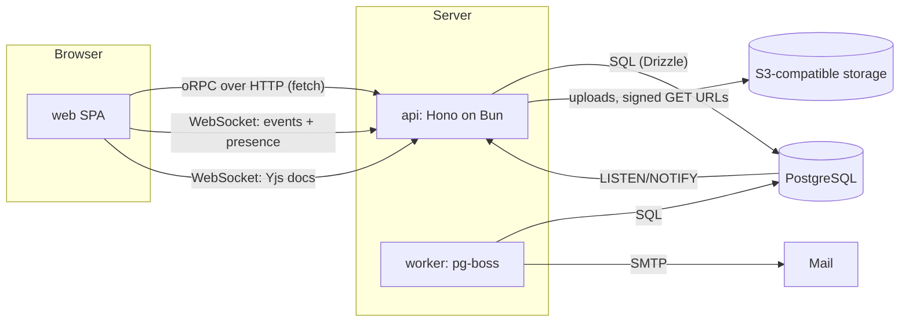

# Architecture

## Workspace layout

```
apps/
  api/        Hono on Bun — oRPC procedures, OpenAPI, auth routes, WebSocket gateway
  worker/     pg-boss consumers — outbox relay, email delivery, hourly digests, outbox pruning
  web/        Vite + React 19 SPA — TanStack Router, TanStack Query, Tailwind v4
  site/       Astro — the landing page and Starlight docs
packages/
  contract/   oRPC contract + Zod schemas: the single source of truth for wire shapes
  db/         Drizzle schema, migrations, seed and the tenant-scoped query helpers
  domain/     Pure business logic with no I/O: workflows, ordering, estimates, sprint metrics
  auth/       Better Auth server config and the access-control statements shared by api and web
  realtime/   Event envelope types, channel naming and the client/server message protocol
  email/      React Email templates
  ui/         Design tokens and React Aria based components, owned in-repo
  tsconfig/   Shared TypeScript configs
```

Dependency direction is one-way: `apps/* → packages/*`, and inside packages
`contract → domain`, `db → domain`. `domain` depends on nothing but Zod. The web app never imports `db`.

## Runtime topology



Only two stateful services: PostgreSQL and object storage. There is no Redis.

## Request path

1. Hono middleware: request id, structured logging, secure headers, CORS. Auth endpoints are rate limited by
   Better Auth, with its counters in Postgres.
2. Better Auth resolves the session cookie into a user; on `/api/v1` a personal access token (`Bearer tf_…`)
   may stand in for it, pinned to one organization and, if read-only, to GET requests.
3. oRPC middleware builds the `Context`: actor, active organization, membership role, and a `Scope` object that
   is the only way to reach tenant-owned tables.
4. The procedure validates input with the contract's Zod schema, calls a service, and returns a contract-typed
   output. Errors are typed oRPC errors (`NOT_FOUND`, `FORBIDDEN`, `CONFLICT`, …) declared in the contract.

## Write path and events

Every mutation runs in one transaction that:

1. changes the rows,
2. appends to `activity` (the per-task, append-only history the analytics are computed from),
3. appends to `outbox` (domain events to publish).

After commit, `pg_notify('outbox', id)` wakes the relay in the worker, which:

- publishes the event with `NOTIFY teamflow_events` (every api node listens, and forwards it to the sockets
  subscribed to its channel),
- leaves follow-up work to pg-boss jobs (emails and digests). Notifications themselves are written
  in the mutation's own transaction (ADR-0012) and only _announced_ through the outbox.

Because the outbox row is written in the same transaction as the change, an event can be delayed but never lost or
invented. The relay is idempotent on the outbox id.

## Real-time

- One WebSocket per tab, multiplexed: clients subscribe to channels (`org`, `me`, `project:<id>`), always relative
  to the session's organization. Subscriptions are authorized on join.
- Server events carry the entity and its new `version`; the client patches the TanStack Query cache in place and
  ignores events whose version is not newer than what it has (its own optimistic writes included).
- Presence (who is looking at a project, and which task each person has open) is ephemeral, kept in memory per
  api node and fanned out over `NOTIFY`; it never touches a table.
- Collaborative descriptions use Yjs. The api hosts the Yjs WebSocket provider, persists merged document state to
  `task_document` (bytea) with debounced writes, and derives a plain-text projection for search.

## Ordering

Board columns and the backlog are ordered by a fractional index string (`rank`). Moving a card writes one row and
never renumbers neighbours. Two clients inserting in the same gap get distinct keys because a short random suffix is
appended. Keys grow only when people keep inserting into the same gap; `needsRebalance` detects that, but no job
acts on it yet, because realistic use stays far below the threshold.

## Tenancy

Shared schema, every tenant-owned table carries `organization_id`. Isolation is enforced in the application layer by
construction rather than by convention — see ADR-0004:

- Tenant-owned tables are only reachable through `scope.db`, a Drizzle wrapper bound to one organization that adds
  the `organization_id` predicate and fills it on insert.
- Foreign keys between tenant-owned tables are composite (`organization_id, id`), so a row cannot point across
  tenants even if a query is wrong.
- A test enumerates the Drizzle schema and fails if a tenant-owned table lacks the column, the composite key, or a
  case in the isolation suite.

## Analytics

Burndown, scope change, velocity, cycle time and cumulative flow are pure functions in `packages/domain` over the
`activity` stream for a sprint. The api loads one sprint's changes and replays them; nothing is precomputed except
the committed and completed points recorded on a sprint when it starts and completes, which velocity reads.

## Observability

Structured JSON logs (pino) with a request id, method, path, status and duration on every request, errors logged
with their cause, and a `/health` (liveness) plus `/ready` (database reachable) pair.
